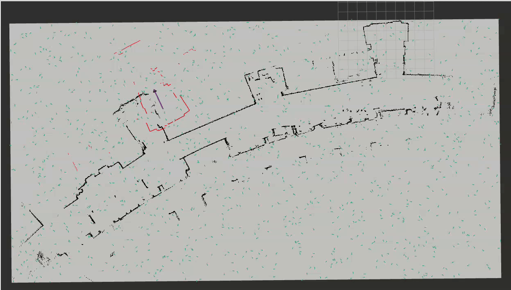

# Robot Localization
### River Lewis & Pepper Wang

## Introduction

The goal of this project was to make a particle filter that, given a map, robot LiDAR scans, and robot odometry readings, can locate the robot's current position and starting position on the map.

Figure 1: The particle filter running (sped up 10x). After some initial bad guesses, it converges on the correct location of the robot, and the LiDaR scan data aligns well to the walls of the map.

## Implementation
Our particle filter undertakes the following steps:
- Initialize $n$ particles using uniform distributions for $x$ (meters, based on map dimensions), $y$ (meters, based on map dimensions), and $\theta$ (radians, between $-\pi$ and $\pi$).
- Every time the robot has moved far enough (based on configurable thresholds), do the following steps:
- Move each particle corresponding to how the robot moved. If our wheels tell us we moved 1 meter forward and $\frac{\pi}{6}$ radians counterclockwise, all our particles should do the same.
    - Given our initial odometry pose $x_{i/O}, y_{i/O}, \theta_{i/O}$, our final pose $x_{f/O}, y_{f/O}, \theta_{f/O}$, and a set of particles $P$:
    - We represent all poses as affine homogeneous transformation matrices, where the affine matrix $P_{A/F}$ for a pose $x_{P/F}, y_{P/F}, \theta_{P/F}$ is:
    $$ \begin{bmatrix}
    \cos{\theta_{P/F}} & -\sin{\theta_{P/F}} & x_{P/F} \\
    \sin{\theta_{P/F}} & \cos{\theta_{P/F}}  & y_{P/F} \\
    0            & 0             & 1
    \end{bmatrix}$$
    - For each particle:
        - We first add Gaussian noise to the particle's original pose proportional to how far the odometry moved. This accounts for the noise in the robot's odometry, and helps spread our particles out somewhat.
        - We compute the transform from the robot's initial pose in the odometry frame $I_{A/O}$ to the particle's pose in the map frame $P_{IA/M}$:
        $$T = P_{IA/M}I_{A/O}^{-1}$$
        - Then, we apply this transformation to the robot's final pose in the odometry frame $F_{A/O}$ to get the particle's final pose in the map frame $P_{FA/M}$:
        $$P_{FA/M}=TF_{A/O}$$
        - Finally, we extract the particle's pose tuple out of the matrix:
        $$x_{P/M}=P_{FA/M}[0,2]\\
        y_{P/M}=P_{FA/M}[1,2]\\
        \theta_{P/M}=\mathrm{atan2}(P_{FA/M}[1,0],P_{FA/M}[0,2])$$
        
- Use the map and the robot's LiDAR scan to score each particle.
    - We use a modified occupancy field class that is capable of calculating distances for cells a small distance outside of the original map.
    - For each particle:
        - Project the laser scan onto that particle's pose, by multiplying the $3\times n$ matrix of scan points with the affine transformation matrix corresponding to the particle's pose.
        - For each projected laser scan point, evaluate how far it is from the nearest obstacle on the map, then sum the squares of all these distance values.
        - We settled on squaring each distance after some testing - if the values are squared, it punishes larger values more.
        - Divide that sum of squares by the number of laser points, and store that as the particle score.
- Calculate particle weights.
    - We used a softmax function to turn all particle scores into a distribution (with weights that add to 1, where higher weight of a particle corresponds to a higher chance of the robot being there):
    $$ w_i = \frac{b^{z_i}}{\sum_{j=1}^{n}b^{z_i}} $$
    where $w_i$ is the weight of the ith particle, and $z_i$ is the     previously determined score of the ith particle.
    - When the value of $b$ in the softmax function is $0<b<1$, lower scores (so small average distances between a particle's lidar scan and expected walls) become lower weights. The exact value of $b$ determines the spikiness of the distribution, or roughly how much more likely the lowest score should be than the next lowest score. We settled on a value of $0.4$ after experimentation.
- Update our estimate for robot current position.
    - We use the single highest weighted particle as our robot pose estimate.
- Resample particles.
    - We sample the majority of particles using the weights of the existing particles as a probability distribution
    - However, we set aside some proportion of particles (we found 30% to work well) to be placed based on a uniform distribution instead, so that if we get unlucky with particle placement, we won't get stuck resampling solely based off those bad particles.
    - Because we're solving the "Kidnapped Neato Problem" and don't use an initial pose estimate, this uniform distribution is particularly important, since it prevents us from being stuck in a bad initial guess.

## Design decisions

### Observation update strategy
To score each particle, we project the laser scan onto that particle and calculate the average square distance from each projected laser point to the nearest obstacle. The closer this number is to zero, the better the particle is - a LiDaR point means that an obstacle exists there, so a LiDaR scan for the ideal particle should have zero distance in this metric.

We originally used a much simpler observation update - we took the closest LiDaR point and scored each particle based on how well its distance to the nearest obstacle on the map was to that minimum LiDaR distance. However, this threw away lots of information, and never converged. We chose this approach because it would be simple to implement and we wanted to reach a minimum functional filter before trying to improve anything. Once we got the filter running, this was the first thing we changed.

If we had more time, we would have liked to try an even more elaborate observation update involving ray-tracing to make sure that laser points weren't shooting through walls. The added accuracy this approach would have provided didn't turn out to be needed for the filter to function.

### Normalization strategy
To turn the particles' scores into weights that form a probability distribution, we used a softmax function instead of alternatives we considered (such as using reciprocals and mean normalization) because of its ability to easily tune the "spikiness" of the distribution.

## Testing

### Unit tests

We used Pytest to unit test each of our functions for steps in the algorithm:
- Initialize particles
- Update particles with odom
- Weight particles based on laser
- Normalize particles
- Update robot pose
- Resample particles

The `ParticleFilter` node class, as well as `TFHelper` and `OccupancyField`, which it depends on, contain subscribers, `TFPublisher`s, and other components that must interface with ROS. This made it not possible to unit test without starting ROS. To work around this, we created inert versions of each of these classes that contain everything needed to run the functions being tested, but do not make any external calls.

Unit testing revealed a major error in the odometry update step: a copy-paste error resulted in using $\theta$ instead of $y$ in a few places. However, because we wrote the unit test some time after implementing the function, this bug existed undetected for several days. This delay was partially due to not knowing how to properly unit test with ROS at the beginning of the project - in future, we'd plan to write tests much earlier, so they can assist with initial development instead of just validating it.

These tests are located in `robot_localization/test_pf.py`. At the time of submission, all tests pass.

### Integration tests

To test the overall code, we used `rviz2` to visualize the map, the current robot pose estimate and the corresponding LiDAR scan, and the particle clouds. We used the provided map of the 1st floor MAC hallway with the bag files that were recorded in that hallway. We also tested using the Neato gauntlet world and teleop control.

To tune many aforementioned parameters (such as the value of $b$ in the softmax function, the proportion of particles to sample uniformly, and what power to put the laser point distances to), we ran the simulation in rviz2 and watched the particle filter run. We often ran using the same parameters multiple times to gauge its effectiveness, because of the randomness involved. We tuned one parameter at a time until we found a combination of values that worked well.

## Trials, Tribulations, and Lessons Learned

Our biggest challenge was figuring out how to write the unit tests, as described above. We considered other options such as trying to programmatically spin up other ROS nodes, or using Pytest mocking tools to imitate those other nodes, but decided on our approach of using inert classes after talking with Victoria. This approach is simpler to implement, but doesn't scale or mirror ROS functionality as well as the other approaches might have. However, since we only had to test a few functions, and those functions only relied on a few outside services, this tradeoff was worth it for us. For future projects however, especially ones more focused on integration and multi-node interaction, it may be worth looking into approaches such as automated Gazebo test routines or the ROS documentation on integration tests.

Our teaming approach of fully synchronous work turned out very well. We both have a good understanding of the code across the entire project. However, for much larger projects, only doing work during meetings is unlikely to scale well, so we'd want to pick and choose the most conceptually important components to build synchronously.

## How to run
### Setup
1. Set up an appropriate ROS2 Jazzy workspace with the standard CompRobo instructions.
2. Clone this repository into `<your_ros_workspace>/src/comprobo_robot_localization`.
3. Install the `scikit-learn` Python package, which is used for nearest-obstacle calculations. If your workspace is set up according to the standard CompRobo instructions, then `python -m pip install --break-system-packages scikit-learn` should do the job. (If you land in Numpy dependency hell, you have our condolences - you might try `sudo apt install python3-sklearn` instead, but unfortunately no single solution can guarantee your escape.)
4. From the root of your workspace, run `colcon build --symlink-install` and re-source all your ROS2 workspace setup files.

### Run the particle filter on recorded data
To run the particle filter on a recorded run of a robot, do the following:
1. In one terminal, from your ROS workspace root, run `ros2 launch robot_localization test_pf.py map_yaml:=./src/comprobo_robot_localization/maps/mac_1st_floor_final.yaml`.
2. In another terminal, from your ROS workspace root, run `rviz2 -d ./src/comprobo_robot_localization/rviz/turtlebot_bag_files.rviz`.
3. In a third terminal, from your ROS workspace root, run `ros2 bag play ./src/comprobo_robot_localization/bags/macfirst_floor_take_<1 or 2> --clock`.

### Watch a prerecorded demo
To watch a prerecorded run of the particle filter, do the following:
1. In one terminal, from your ROS workspace root, run `rviz2 -d ./src/comprobo_robot_localization/rviz/turtlebot_bag_files.rviz`.
2. In another terminal, from your ROS workspace root, run `ros2 bag play ./src/comprobo_robot_localization/bags/pf_localizing_mac_take_<1 or 2>/ --clock`.